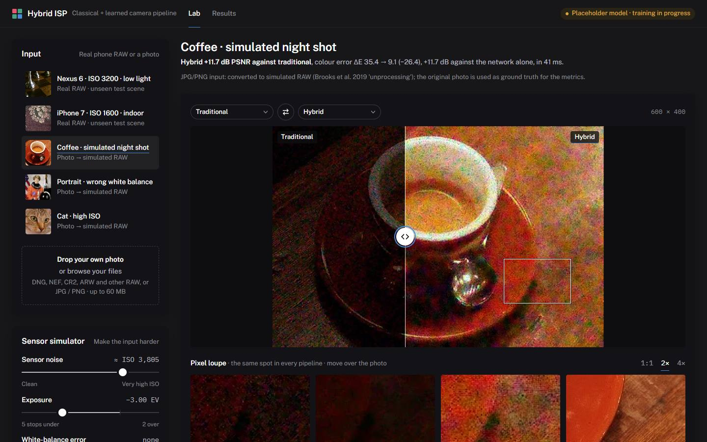

# Hybrid ISP: a classical + learned smartphone camera pipeline

**Live demo: https://amplifier-addition-gains-clip.trycloudflare.com** · Computer Vision Hackathon 2026, Problem P2

Works on phone and laptop. Served from the team's machine through a Cloudflare tunnel (`scripts/start_public.bat`); the same app also runs anywhere with the `Dockerfile`, or on Modal (`modal_app.py`).

Turns noisy, badly exposed, wrongly white-balanced smartphone **RAW** into a clean sRGB photo. Classical
ISP stages do the parts that are exact (black level, white balance, demosaicing, the calibrated colour matrix,
tone curve). A compact learned RAW denoiser does the part classical filters do badly. An adaptive router
decides, photo by photo, how much of the network each image needs, and the app explains why.



## What you can do on the live site
- **Pick a real phone RAW** (SIDD Nexus 6 / iPhone 7, from scenes the network never saw), a photo, or **upload your own** DNG/RAW/JPG/PNG.
- **Make it harder** with the sensor simulator: add ISO noise, under-expose by up to 5 stops, or break the white balance.
- **Compare** Traditional | Learned only | Hybrid (and ground truth) with a split view and a **pixel loupe** that shows the same spot in every pipeline at 1:1 to 4×.
- **See the scores** (PSNR, SSIM, ΔE2000, time) and **why the router chose its path** (noise σ, exposure, white-balance trust, dynamic range).
- **Look inside** each pipeline stage by stage, from the Bayer mosaic to the final photo, with the time spent in each stage.
- **Results tab:** full test-set metrics, robustness curves, the ablation study and failure cases.

## Results (held-out SIDD-CC test scenes 004 and 008, 26 images, 5 phones)
<!-- results:start -->
Held-out SIDD-CC test scenes 004, 008: 26 images from 5 phones, centre 1536x1024 crops, never seen in training or tuning. Model: LightweightISPUNet (SIDD-CC RAW denoiser) (`isp_unet.onnx`). Updated 2026-11-07 09:20.

| Pipeline | PSNR (dB) ↑ | SSIM ↑ | ΔE2000 ↓ | LPIPS ↓ | Time / image |
|---|---:|---:|---:|---:|---:|
| Input (no ISP) | 25.26 | 0.5850 | 11.60 | 0.4005 | n/a |
| Traditional ISP | 25.40 | 0.6493 | 7.73 | 0.5171 | 176 ms |
| Learned only | 28.37 | 0.7553 | 6.41 | **0.3609** | 440 ms |
| **Hybrid (ours)** | **29.84** | **0.8016** | **5.34** | 0.3651 | 576 ms |

RAW-domain denoising (packed RGGB vs clean RAW): noisy **40.34 dB** → network alone **40.96 dB** → network inside the noise-model bound (as deployed) **43.39 dB**. In bright regions the network alone is worse than its input (30.08 → 28.24 dB); inside the bound it improves on it (31.32 dB), and the images it damages drop from 14 to 2 of 26.

**Efficiency** (optimisation: static INT8 post-training quantisation):

| Model | Parameters | Size | CPU latency, 1 MP RAW |
|---|---:|---:|---:|
| ONNX FP32 | 1,004,996 | 4.04 MB | 242 ms |
| ONNX INT8 | 1,004,996 | 1.16 MB | 184 ms |

**Robustness** (mean PSNR over the robustness subset as each degradation grows):

- **Added sensor noise** (worst level, 12800 approx. ISO): hybrid 20.34 dB, learned only 19.50 dB, traditional 14.78 dB.
- **Under-exposure** (worst level, -4.0 EV): hybrid 24.63 dB, learned only 11.25 dB, traditional 11.29 dB.
- **White-balance error** (worst level, 1.0 error (fraction of R/B gain)): hybrid 20.14 dB, learned only 19.43 dB, traditional 18.68 dB.

Full tables, curves, the ablation study and failure cases: the website's **Results** tab, [`results/benchmarks.json`](results/benchmarks.json) and [`docs/failure_cases.md`](docs/failure_cases.md).
<!-- results:end -->

**Figures** (low light, backlit scenes, bright-region preservation, intermediate states) and the **ablation study** (with vs without each module, fixed vs adaptive routing): [docs/design.md §6.1–6.2](docs/design.md#61-visual-outputs-and-intermediate-states).

## Run it

**One command (Docker):**
```bash
docker build -t hybrid-isp . && docker run -p 7860:7860 hybrid-isp
# open http://localhost:7860
```

**Local development:**
```bash
python -m venv .venv && .venv\Scripts\activate          # Windows (use bin/activate elsewhere)
pip install -r requirements.txt
cd web && npm ci && npm run build && cd ..
uvicorn server.main:app --port 7860                        # API + site on http://localhost:7860
# UI hot reload: cd web && npm run dev  (proxies /api to :7860)
```

No GPU and no PyTorch are needed to run the app: the learned core runs through ONNX Runtime on the CPU.
Without trained weights in `models/`, a classical stand-in with the same interface runs, and the UI says so.

## How it fits together
See **[docs/architecture.md](docs/architecture.md)** (diagram + data contract) and **[docs/design.md](docs/design.md)** (design document).

```
RAW / DNG / JPG ─► isp/io.py ─► simulate.py ─► analysis.py (analyser + router)
                                                   │
          ┌──────────────── isp/pipelines.py ──────┼─────────────────────────────┐
          │ Traditional: WB → Malvar → bilateral → CCM → tone → sharpen          │
          │ Learned:     packed RAW → network → minimal render                    │
          │ Hybrid:      network (RAW denoise) → router WB + gain → Malvar → CCM  │
          │              → tone → chroma cleanup → noise-aware sharpen            │
          └─────────────── isp/model_slot.py ◄── models/model.json + *.onnx ──────┘
FastAPI (server/) serves the API and the React site (web/), in one Docker image.
```

## Reproduce the model and the numbers
1. **Train** on a free GPU: run [`training/SIDD_CC_RAW_Complete_Pipeline.ipynb`](training/SIDD_CC_RAW_Complete_Pipeline.ipynb) on Kaggle or Colab (T4). It downloads SIDD-CC (~7 GB), splits by scene (7 train / 1 val / 2 test), trains `LightweightISPUNet` (1.0 M parameters), then exports ONNX FP32 + static INT8 and `exported_model.zip`. `ISP_NB_QUICK=1` runs a 2-minute CPU dry run of every cell.
2. **Plug it in:** copy `isp_unet*.onnx` and `model.json` into `models/`, then run `python scripts/check_model.py`.
3. **Evaluate** (dev requirements: `pip install -r requirements-dev.txt`):
   ```bash
   python eval/prepare_testset.py              # cache the 26 held-out test pairs
   python eval/prepare_testset.py --split val  # cache the validation scene
   python eval/tune_router.py                  # router thresholds, validation scene only
   python eval/run_eval.py --team-id <ID> --usns "<USN1>,<USN2>,<USN3>,<USN4>"
   ```

## Repository layout
```
isp/            classical stages, analyser + router, model slot, pipelines, metrics, input loading
server/         FastAPI app (API + static site)            web/        React + Vite + TypeScript UI
models/         model.json + ONNX weights (the slot)        samples/    demo inputs (SIDD test scenes, photos)
training/       training notebook, model class, notebook patcher
eval/           test/val set builders, router tuning, full evaluation   results/   benchmarks.json, failure images
scripts/        export_onnx.py, check_model.py, make_samples.py, deploy_space.py
docs/           architecture.md, design.md, failure_cases.md
```

## Limitations
- The network **denoises RAW**; colour is classical and calibrated rather than learned (see the design doc §8).
- sRGB ground truth is the clean SIDD RAW rendered with our own colour and tone stages: it compares the pipelines fairly with each other, but not with numbers from other papers.
- SIDD has 10 physical scenes; the test split holds 2 of them (26 images, 5 phones).
- The web demo bins inputs to ≤ 2 MP for speed; the official metrics are computed offline on full 1536×1024 crops.

## Privacy and ethics
Uploads are processed in memory and never stored, and outputs carry no metadata. The data is public: SIDD (research use) and public-domain test images. See the design doc §9.

## Team Ragebaiters (T27)
Varsha Lokesh (1RUA24CSE0515) · Thanvi Kiran Bhat (1RUA24CSE0499) · Subika Kumari (1RUA24CSE0480) · Vinochan Rajesh (1RUA24CSE0534)

Evaluation report: [`eval_P2_T27.md`](eval_P2_T27.md).

## Credits
- **SIDD:** A. Abdelhamed, S. Lin, M. S. Brown, CVPR 2018 (SIDD-CC compact release on Hugging Face, `MhdMohammadi/SIDD-CC`).
- **Unprocessing:** T. Brooks et al., CVPR 2019. **Demosaicing:** Malvar, He, Cutler, ICASSP 2004. **LPIPS:** Zhang et al., CVPR 2018.
- **Photos:** scikit-image test images (public domain / CC0). **Fonts:** Public Sans and IBM Plex Mono (SIL OFL), self-hosted.
- **Model:** `LightweightISPUNet` and the SIDD-CC training pipeline by the team's model lead (`training/`).
