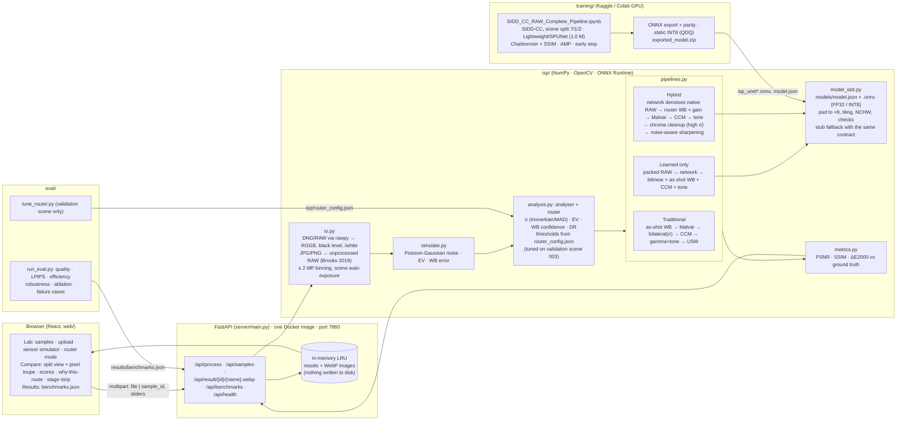

# System architecture

## Data contract between the components

| Boundary | Format |
|---|---|
| Any input → pipelines | `RawImage` (`isp/raw.py`): RGGB Bayer float32, black level removed, divided by white level, negatives kept (noise floor); `wb_gains` (as-shot, G=1); `cam2rgb` (from DNG/SIDD `ColorMatrix2`, dcraw convention); `exposure` (scene baseline, applied by every pipeline); optional `gt` |
| Pipelines → network | `raw4`: packed `[R, G1, G2, B]`, (H/2, W/2, 4), no WB, unclipped. Exactly the training notebook's input |
| Network → pipelines | `raw4` denoised (same shape); declared in `models/model.json` |
| Server → browser | JSON (`server/schemas.py`) + WebP images by URL; errors as `{error: {code, message, hint}}` |
| Eval → browser | `results/benchmarks.json` (schema in `web/src/api.ts`) |

## Why the order inside the hybrid is what it is

1. **The network sees the RAW it was trained on.** SIDD-CC pairs are black-level-subtracted, normalised and not white-balanced, so the hybrid runs the learned denoiser on native RAW *before* white balance or digital gain. Gain applied first would push the noise outside the training distribution.
2. **Colour is decided classically, after denoising.** The router checks the as-shot white balance against a shades-of-gray estimate and corrects it only when they disagree strongly. The scene's colour matrix and an exact sRGB transfer function follow, so colour does not depend on what the network happened to learn.
3. **Exposure gain comes after denoising**, so it amplifies a clean signal, not the noise.
4. **Sharpening is noise-aware and measured after denoising**: its strength is set from the noise that is *left*, `k / (1 + σ_residual·gain / σ0)`.
