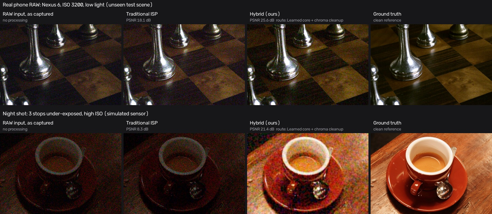
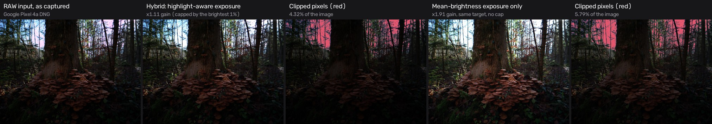
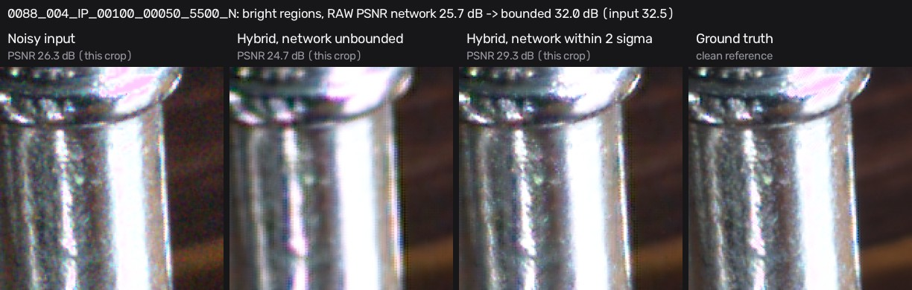
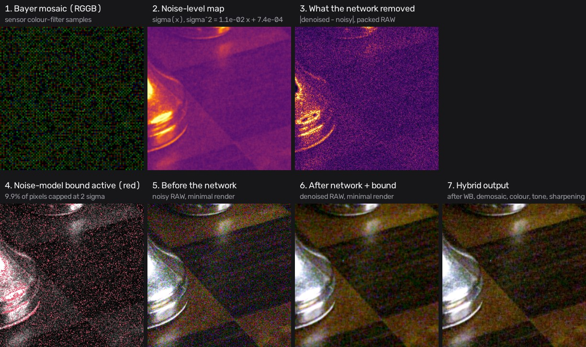
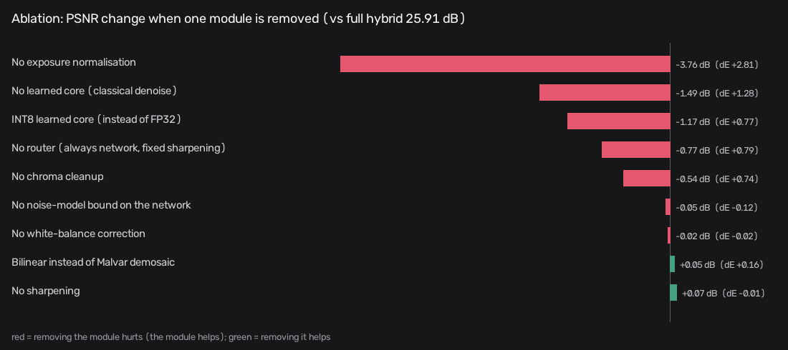

# Design document: Hybrid smartphone ISP (Problem P2)

## 1. Problem
Turn degraded smartphone RAW sensor data (noise, colour distortion, varying illumination, white-balance errors) into a high-quality sRGB image with good colour accuracy, low noise and good detail, at a compute cost that suits a phone. The solution must be **hybrid**: classical ISP stages and learned components working together, compared against a traditional pipeline and against the network alone.

## 2. Goals and success measures
| Goal | Measure (in the brief's order) |
|---|---|
| Fidelity | PSNR, SSIM against the clean ground truth |
| Colour accuracy | mean CIEDE2000 (ΔE) |
| Perceptual quality | LPIPS (AlexNet) |
| Model cost | parameters, model size |
| Speed and memory | CPU inference latency at 1 MP, peak memory |
| Robustness | PSNR as noise, under-exposure and WB error grow |

## 3. Data
- **SIDD-CC** (Abdelhamed et al., CVPR 2018; compact release on Hugging Face `MhdMohammadi/SIDD-CC`): paired noisy/clean RAW from 5 phones (Galaxy S6, iPhone 7, Pixel, Nexus 6, LG G4), 10 physical scenes, ISO 50–10 000, with metadata (CFA pattern, black/white level, AsShotNeutral, ColorMatrix2).
- **Split by physical scene** (seed 42): 7 train / 1 validation (scene 003) / 2 test (scenes 004, 008). No scene appears in two splits, so the test numbers measure generalisation to unseen scenes.
- **Router thresholds are tuned on the validation scene only** (`eval/tune_router.py`); the test scenes are used once, by `eval/run_eval.py`.
- Photos uploaded as JPG/PNG are converted to simulated RAW by **unprocessing** (Brooks et al., CVPR 2019): inverse tone curve, inverse gamma, inverse colour matrix, inverse white balance, Bayer mosaic. The original photo then serves as ground truth.

## 4. Architecture
See [architecture.md](architecture.md) for the diagram and the data contract.

### 4.1 Classical stages (`isp/classical/`)
| Stage | Method | Why |
|---|---|---|
| RAW preprocessing | black level per CFA channel, normalise to the white level, align any Bayer pattern to RGGB, keep negative noise values | exact and cheap; the network needs unclipped noise statistics |
| White balance | as-shot gains (metadata); gray-world and shades-of-gray (p=6) estimators | metadata is usually right; estimators catch the cases where it is not |
| Demosaic | Malvar-He-Cutler 5×5 (2004); bilinear for the learned-only baseline | high quality at linear cost |
| Denoise | noise-aware bilateral (traditional), guided filter (fast path), chroma-only bilateral (high noise) | edge-preserving; chroma-only cleanup removes colour blotches without softening detail |
| Colour | camera→sRGB matrix from `ColorMatrix2` (inverse of the row-normalised `ColorMatrix2 · sRGB→XYZ`) | calibrated colour, per camera |
| Tone | exact sRGB transfer function + smoothstep S-curve (16-bit LUT); CLAHE local tone for very high dynamic range | the forward model is exactly invertible, so unprocessed photos round-trip |
| Sharpen | unsharp mask on luma only, amount `k / (1 + σ/σ0)` | sharpening never amplifies colour noise; it backs off on noisy images |

### 4.2 Learned component
- **LightweightISPUNet** (team, `training/unet_isp.py`): residual U-Net on packed RAW (`[R, G1, G2, B]`, H/2×W/2), 4 levels, depthwise-separable residual blocks, PixelShuffle upsampling, global residual (`clean = noisy + f(noisy)`). **1,004,996 parameters (3.83 MB FP32).**
- Trained on SIDD-CC patches (128×128 packed): Charbonnier + 0.1·(1−SSIM) loss, AdamW, cosine schedule, mixed precision, CFA-safe flips and rotations, early stopping on validation PSNR, resumable checkpoints.
- **Optimisation:** exported to ONNX (parity with PyTorch below 1e-4), then **static INT8 post-training quantisation** (ONNX Runtime QDQ, per-channel weights, calibrated on validation patches). The final residual add stays in FP32 so quantisation noise is not added to the image. FP16 is benchmarked on GPU in the notebook.

### 4.3 Hybrid integration and the adaptive router (`isp/analysis.py`, `isp/pipelines.py`)
The analyser measures the RAW before anything else runs:
- the noise σ (Immerkær Laplacian with a median, so it ignores texture);
- the exposure offset (the same highlight-aware auto-exposure used for the scene, on 4×-binned data);
- trust in the white balance (angle between the as-shot and shades-of-gray illuminants);
- the dynamic range (floored at the noise level).

The router then decides:

| Condition | Action |
|---|---|
| visible noise σ_eff < `fast_sigma` | fast path: skip the network, use a guided filter |
| `fast_sigma` ≤ σ_eff < `high_sigma` | learned core |
| σ_eff ≥ `high_sigma` | learned core + chroma-only cleanup, weaker sharpening |
| under-exposed beyond `ev_threshold` | digital gain (≤ ×16) **after** denoising |
| WB disagreement > `wb_angle_lo` **and** the estimators agree (spread ≤ `wb_spread_max`) | blend towards shades-of-gray; replace beyond `wb_angle_hi` |
| WB estimators disagree with each other (colourful scene) | keep the camera's as-shot WB |
| no WB metadata | shades-of-gray |
| dynamic range > `local_tone_dr` stops | local tone mapping |
| always, after the network | **noise-model trust region:** a correction is limited to `residual_k`·σ(x) |

Every decision is reported as a sentence ("why this route") in the UI. Thresholds live in `isp/router_config.json`, tuned on the validation scene only by `eval/tune_router.py`.

**Two classical safeguards around the network** (both found on real data, see [failure_cases.md](failure_cases.md)):
- **Noise-model trust region:**
  - The sensor's noise-level function σ²(x) = a·x + b is fitted from each image (`estimate_nlf`): the local high-pass variance per brightness bin, flat regions only.
  - The network may change a pixel by at most k·σ(x).
  - So it can remove noise but cannot erase real detail or shift highlights. It fixed the network's over-smoothing of bright regions, which its mostly dark training data never taught it.
- **White-balance consensus:**
  - The camera's as-shot WB is only second-guessed when gray-world, shades-of-gray and gray-edge agree with each other (within 4°).
  - On colourful scenes they disagree, so the camera is trusted. This fixed a sunflower DNG turning blue.
  - Highlights are excluded relative to the image (the brightest 2%), so the estimate doesn't change with exposure.

**Order inside the hybrid** (and why), from [architecture.md](architecture.md):
1. Network on native RAW, its training distribution, then the noise-model trust region.
2. Router white balance and gain.
3. Malvar demosaic.
4. Calibrated colour matrix.
5. Tone.
6. Chroma cleanup.
7. Noise-aware sharpening.

### 4.4 Application
- **FastAPI server:** the API and the built React site in one Docker image (port 7860, non-root user). It holds results in an in-memory LRU cache; uploads are never written to disk, and outputs are re-encoded as WebP, so no EXIF or GPS survives.
- **Inputs:** DNG and most camera RAWs (via LibRaw), plus JPG/PNG/WebP. X-Trans and corrupt files get a clear message.
- **Speed:** inputs are capped at 2 MP by Bayer-aware binning to stay inside the ~10 s budget on 2 shared vCPUs; the built-in samples are precomputed at start-up.
- **Model slot** (`isp/model_slot.py`): the only place a network plugs in. `models/model.json` declares its input and output (`raw4`, `rgb`, `srgb`, `linear_*`), padding, layout and tiling; ONNX, TorchScript or a Python `predict()` file all load. A classical stand-in with the same contract keeps the app working without weights.

## 5. Evaluation protocol
- `eval/run_eval.py`: one noisy/clean pair per test instance (26 instances, scenes 004 and 008, all 5 phones), centre crop 1536×1024.
- Every pipeline renders with the same colour matrix and tone stages, and the ground truth is the clean RAW rendered by those same stages. Differences therefore come from denoising, demosaicing, white balance, exposure and sharpening, not from a different rendering.
- Robustness sweeps add sensor noise (Poisson-Gaussian, Brooks et al. parameters), under-exposure (−1 to −4 EV) and white-balance error (up to ±45% on R/B gain) to the real noisy RAW.
- Ablation removes one hybrid component at a time, averaged over three conditions.
- Results: [`results/benchmarks.json`](../results/benchmarks.json), [`eval_P2_<TeamID>.md`](../), and the website's Results tab.

## 6. Results
<!-- results:start -->
Held-out SIDD-CC test scenes 004, 008: 26 images from 5 phones, centre 1536x1024 crops, never seen in training or tuning. Model: LightweightISPUNet (SIDD-CC RAW denoiser) (`isp_unet.onnx`). Updated 2026-11-07 09:20.

| Pipeline | PSNR (dB) ↑ | SSIM ↑ | ΔE2000 ↓ | LPIPS ↓ | Time / image |
|---|---:|---:|---:|---:|---:|
| Input (no ISP) | 25.26 | 0.5850 | 11.60 | 0.4005 | n/a |
| Traditional ISP | 25.40 | 0.6493 | 7.73 | 0.5171 | 176 ms |
| Learned only | 28.37 | 0.7553 | 6.41 | **0.3609** | 440 ms |
| **Hybrid (ours)** | **29.84** | **0.8016** | **5.34** | 0.3651 | 576 ms |

RAW-domain denoising (packed RGGB vs clean RAW): noisy **40.34 dB** → network alone **40.96 dB** → network inside the noise-model bound (as deployed) **43.39 dB**. In bright regions the network alone is worse than its input (30.08 → 28.24 dB); inside the bound it improves on it (31.32 dB), and the images it damages drop from 14 to 2 of 26.

**Efficiency** (optimisation: static INT8 post-training quantisation):

| Model | Parameters | Size | CPU latency, 1 MP RAW |
|---|---:|---:|---:|
| ONNX FP32 | 1,004,996 | 4.04 MB | 242 ms |
| ONNX INT8 | 1,004,996 | 1.16 MB | 184 ms |

**Robustness** (mean PSNR over the robustness subset as each degradation grows):

- **Added sensor noise** (worst level, 12800 approx. ISO): hybrid 20.34 dB, learned only 19.50 dB, traditional 14.78 dB.
- **Under-exposure** (worst level, -4.0 EV): hybrid 24.63 dB, learned only 11.25 dB, traditional 11.29 dB.
- **White-balance error** (worst level, 1.0 error (fraction of R/B gain)): hybrid 20.14 dB, learned only 19.43 dB, traditional 18.68 dB.

Full tables, curves, the ablation study and failure cases: the website's **Results** tab, [`results/benchmarks.json`](../results/benchmarks.json) and [`docs/failure_cases.md`](failure_cases.md).
<!-- results:end -->

### 6.1 Visual outputs and intermediate states
All figures come from the real pipeline and the trained network (`python scripts/make_figures.py`). The numbers come from `results/benchmarks.json` and `results/bright_regions.json`.

#### Extreme low light: RAW input vs enhanced output

- **Top, real phone RAW** (Nexus 6, ISO 3200, low light, test scene 004, which training never saw):
  - The traditional ISP lifts the image but keeps the grain: 18.1 dB.
  - The hybrid reaches **25.6 dB**, against 16.7 dB for the unprocessed input and 25.0 dB for the network alone.
- **Bottom, night shot** (a photo pushed 3 stops under with heavy sensor noise):
  - Traditional ISP: 8.3 dB. Hybrid: **21.4 dB**.
  - Colour mottling remains. This is the extreme end of what a single frame can recover (failure cases 2 and 3).
- **Under-exposure sweep** (8 test images, 0 to −4 EV):
  - The hybrid goes from 28.98 to **24.63 dB**.
  - Traditional falls from 24.20 to 11.29 dB, and the network alone from 28.16 to 11.25 dB.
  - The network has no exposure stage; the classical exposure normalisation, steered by the router, is what keeps the image usable.

#### Non-uniform and backlit scenes: bright regions without overexposure
The hybrid protects bright regions in two ways.

**1. Highlight-aware exposure** (`analysis.auto_exposure`). The gain brings the mean green to 0.14, but is capped so that the brightest 1% stays below white.

- **Scene:** a Pixel 4a DNG of a dark forest floor against bright sky.
- **With the cap:** the gain is held at **×1.11** instead of ×1.91, and clipped pixels stay at **4.3%** of the image instead of 5.8%.
- **What remains:** part of the sky was already clipped in the sensor (1.4% of RAW pixels sit at white before any gain), and no exposure choice can recover it. The cap stops the ISP from adding much to it.

**2. The noise-model trust region** (`denoise.bound_residual`). The network is trained on mostly dark SIDD patches. Left alone, it over-smooths bright, textured regions. The hybrid fits the sensor's noise-level function σ²(x) = a·x + b on every image, and lets the network move each pixel by at most 2σ(x).

RAW-domain PSNR on all 26 test images. "Bright" means clean RAW above 20% of white, measured on the 13 images with enough bright area.

| | Noisy input | Network alone | Network within 2σ (deployed) |
|---|---:|---:|---:|
| Whole image | 40.34 dB | 40.96 dB | **43.39 dB** |
| Bright regions only | 30.08 dB | 28.24 dB (worse than input) | **31.32 dB** |
| Images made worse than the input | n/a | 14 of 26 | **2 of 26** |

The two images still slightly below their input are ISO 100 shots in good light: 0180 −0.8 dB and 0188 −0.06 dB.

#### Intermediate states

The pipeline is not Retinex-based, so there is no illumination/reflectance split. These are the intermediate representations that steer it:

1. **Bayer mosaic:** the raw RGGB samples every stage starts from.
2. **Noise-level map σ(x):** from the per-image fit σ² = a·x + b. This is the guidance signal. The router reads its level to choose a path, and the trust region uses it per pixel.
3. **What the network removed:** |denoised − noisy|, which works as an attention map. The network acts most on the bright specular edges of the chess piece and on the noise in flat areas.
4. **Where the bound acted:** 9.9% of pixels. They are densest on the bright highlights, where the network's correction exceeds what the noise can explain.
5–7. **The image before the network, after the network and the bound, and the final output** after WB, Malvar demosaic, colour matrix, tone curve, chroma cleanup and noise-aware sharpening.

The router's own state for each photo (σ, exposure EV, white-balance confidence and estimator spread, dynamic range) is shown in the app's "Why this route" panel. Every stage image, with its time, is in the Pipeline view.

### 6.2 Ablation study
**Protocol:** one module is switched off at a time, everything else unchanged. Each variant runs on 8 test images under 3 conditions (as captured; extra noise + 2 EV under-exposure; white-balance error), so 24 runs per variant. The full hybrid scores 25.91 dB / SSIM 0.6971 / ΔE 8.40.

| Removed module | PSNR (dB) | Δ PSNR | SSIM | ΔE2000 | Δ ΔE |
|---|---:|---:|---:|---:|---:|
| Nothing (full hybrid) | **25.91** | | 0.6971 | **8.40** | |
| Exposure normalisation (classical) | 22.14 | **−3.76** | 0.6043 | 11.20 | +2.81 |
| Learned core (classical denoise instead) | 24.42 | **−1.49** | 0.6298 | 9.68 | +1.28 |
| FP32 core (INT8 instead) | 24.74 | −1.17 | 0.6121 | 9.17 | +0.77 |
| Adaptive router (fixed: always network, fixed sharpening) | 25.13 | **−0.77** | 0.6542 | 9.19 | +0.79 |
| Chroma cleanup | 25.37 | −0.54 | 0.6681 | 9.14 | +0.74 |
| Noise-model bound (classical guidance on the network) | 25.86 | −0.05 | 0.7034 | 8.28 | −0.12 |
| White-balance correction | 25.88 | −0.02 | 0.6973 | 8.38 | −0.02 |
| Malvar demosaic (bilinear instead) | 25.95 | +0.05 | 0.7099 | 8.56 | +0.16 |
| Sharpening | 25.97 | +0.07 | 0.7024 | 8.39 | −0.01 |

**Fixed vs adaptive.** All 26 test images under 4 conditions (104 runs):

| Mode | PSNR | ΔE2000 | Time / image | Network used |
|---|---:|---:|---:|---:|
| **Adaptive router** | **27.97 dB** | **6.56** | 874 ms | 97% of runs |
| Fixed: always network | 27.37 dB | 6.97 | 857 ms | 100% |
| Fixed: never network (classical only) | 26.94 dB | 7.53 | 557 ms | 0% |

**What the ablation shows:**
- **Classical guidance carries most of the gain.** Exposure normalisation is the largest single contributor (+3.8 dB). The network cannot do it: it only denoises, with no exposure step, and alone it collapses at −4 EV (11.25 dB vs the hybrid's 24.63).
- **The learned core is the second-largest contributor** (+1.5 dB over the classical denoiser).
- **The adaptive router beats every fixed setting.** It gains +0.6 dB over always using the network and +1.0 dB over never using it, at the same cost as always-network. In the sweeps, switching the router off costs 1.7 dB at the highest noise level and 1.2 dB at −4 EV.
- **The noise-model bound is neutral in sRGB but essential in RAW.** On this subset, −0.05 dB PSNR and −0.12 ΔE are within noise. In RAW it adds +2.4 dB over the whole image and +3.1 dB in bright regions, and it cuts the damaged images from 14 to 2 (§6.1). We keep it because it makes the network safe on inputs unlike its training data.
- **INT8 costs 1.2 dB** for a 3.5× smaller model (4.04 → 1.16 MB) and 1.3× faster inference (242 → 184 ms at 1 MP). FP32 stays the default; INT8 is the option for memory-bound devices.
- **Honest negatives:**
  - Sharpening and the Malvar demosaic cost under 0.1 dB of PSNR. Sharpening is a perceptual choice that PSNR penalises. Bilinear scores higher SSIM but worse colour (+0.16 ΔE, fringing at edges). We keep both for how the image looks.
  - White-balance correction has almost no effect here, because the consensus check (§4.3) leaves the camera's WB in place on most real scenes (see failure case 4).

## 7. Failure cases
See [failure_cases.md](failure_cases.md), generated from the worst test images.

## 8. Limitations
- The learned component **denoises** RAW; it does not learn the colour transform. Colour is classical and calibrated (camera matrix + white balance). We chose this because the brief ranks colour accuracy (ΔE) second and a calibrated matrix is exact. A learned colour/tone head is the natural next step.
- **Ground truth is rendered:** the SIDD-CC clean RAW passed through our own colour and tone stages. sRGB scores therefore compare pipelines fairly with each other, but not with numbers from other papers.
- **Few scenes:** SIDD has only 10 physical scenes, so 2 test scenes is a small sample. Per-image numbers are in `benchmarks.json`.
- **Simulated degradations:** the robustness sweeps add simulated noise, exposure and WB errors to real RAW. Real low-light captures also have row noise, fixed-pattern noise and black-level drift, which are not modelled.
- **Web-demo compromises:** inputs are binned to ≤ 2 MP, and live scores use a centre crop. The official numbers are full-crop, offline.
- **Training stopped early:** the Kaggle run diverged at epoch 13, so the exported model is the epoch-11 checkpoint. The notebook has a fix (float32 loss, lower learning rate) that was not re-run before the deadline.
- **The network alone over-smooths bright regions:** its training data is mostly dark, and in bright regions it scores below its own input (30.08 → 28.24 dB RAW). The hybrid's trust region contains this (31.32 dB, §6.1), but the learned-only baseline shows it.
- **LPIPS prefers the network alone:** it scores slightly better than the hybrid on LPIPS, while the hybrid wins PSNR, SSIM and ΔE. The hybrid's classical sharpening and chroma cleanup trade some perceptual texture for fidelity.
- **Texture vs noise:** fine periodic texture (fabric weave) is indistinguishable from noise for single-photo noise estimators, so the router can over-denoise it. Camera noise metadata (DNG `NoiseProfile`, ISO) would fix this.
- **WB robustness trade-off:** the consensus check means a genuinely wrong camera WB on a colourful scene is left uncorrected (see failure case 4).

## 9. Ethics and privacy
- Uploads are processed in memory and never stored. Results expire from a small in-memory cache, and outputs carry no metadata.
- All data used is public research data (SIDD: research/non-commercial licence) or public-domain test images (scikit-image).
- No people-centric inference is done. The pipeline treats every pixel the same.
- Denoising can remove real detail, and a hallucinated texture would be a fidelity problem. Comparisons are therefore always shown against ground truth when it exists, and the pixel loupe lets anyone inspect the result at 1:1.

## 10. References
- A. Abdelhamed, S. Lin, M. S. Brown. *A High-Quality Denoising Dataset for Smartphone Cameras* (SIDD). CVPR 2018.
- T. Brooks et al. *Unprocessing Images for Learned Raw Denoising.* CVPR 2019.
- H. S. Malvar, L. He, R. Cutler. *High-quality linear interpolation for demosaicing of Bayer-patterned color images.* ICASSP 2004.
- J. Immerkær. *Fast Noise Variance Estimation.* CVIU 1996.
- K. He, J. Sun, X. Tang. *Guided Image Filtering.* ECCV 2010.
- R. Zhang et al. *The Unreasonable Effectiveness of Deep Features as a Perceptual Metric* (LPIPS). CVPR 2018.
- A. Ignatov et al. *Replacing Mobile Camera ISP with a Single Deep Learning Model* (PyNET). CVPRW 2020.
